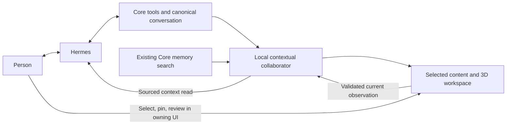

# Local collaboration alongside Hermes

Hermes remains the principal conversation and keeps its native tools. In a
retained personal Hermes conversation, **Affichage contextuel** enables a local
collaborator: useful catalogue views, lists and notes; sourced internal research;
current display observations; and action proposals for human review. The switch
starts unchecked on each browser visit. Family, ephemeral and LLMx sessions do
not enter this capability.



## Conversation and research

The collaborator receives the current request, public reply deltas, bounded
user/assistant history, the validated selected display and actual research
excerpts. It never receives the principal's system, guardian or execution
instructions as advisory data. Hidden reasoning, raw tool output and secret
blocks do not enter this channel. Models, task routes, pins and context-window
settings remain under the existing Core runtime authority.

The existing owner memory-search capability supplies up to three actual document
excerpts, with document/chunk identifiers, source, title, excerpt hash and an
observation time. It retains current-fact filtering, configured relevance floors
and native embedding admission. Missing source identity is rejected; identical
excerpts are deduplicated. No model-named filesystem path is opened and no web
research is duplicated. Hermes retains its own web tools.

Research runs independently of the principal and of visual decisions. Each turn
allows one initial read and at most one refinement for an exactly selected
entity; ambiguous scene candidates do not fan out into searches. Pending, empty,
unavailable and limited research remain explicit. Superseded reads settle through
their native owner and their old result is ignored.

The owner-only `collaboration_context` MCP tool reads one eligible session and
optionally an exact current turn. It returns selected context, sourced excerpts,
freshness and a prepared review, without starting research or inference. This
tool is absent from the shared and family memory buses. Core tells the principal
its session/turn reference in the ordinary selected context. Hermes can pull
new material during its native tool loop; the next ordinary turn also carries
its current selected context. One completed previous-request research result
remains in an explicitly labelled, expiring inbox so a follow-up can read it
while new research is pending. It is never inserted into the new visual decision
as current-topic evidence. This does not inject text into tokens a provider
has already generated or force Hermes to wait for research.

## Visual decisions and human priority

Visual decisions use the existing local conversation inference task, with native
admission and a structured JSON output schema. Core additionally checks exact
supporting quotes, catalogue identifiers, focus grammar, allowed fields and
inert block types. A relevant view can be selected without an explicit display
command. An already useful screen stays in place; no useful grounded information
means no new content. Native evidence choices are exact excerpts supplied by Core; a model does not
retype a quotation from memory. An explicitly empty display stays distinct from
unknown selection. A published valid proposal remains deliverable for its current
turn while reply deltas coalesce, including after a keep decision; a new user
turn or human pause invalidates it immediately. Readiness and the decision
compute phase are separate. Structural validity does not itself establish semantic
relevance: a real-model pilot must receive that separately.

A validated catalogue page remains useful when its optional native focus is
unsupported: Core omits that focus and displays the general view with an explicit
limit. Unknown fields, URLs and unvalidated pages still fail. A requested or
omitted focus never substitutes for the component's actual post-render receipt.

There is one decision inference in flight and one latest pending frame per
session. Deltas coalesce; six calls per turn, 32 active contexts and a five-minute
inactivity TTL bound the work. A superseded admitted inference is allowed to
settle; its old output cannot replace the current topic. Principal progress never
awaits it. GET polling invokes no model. Unavailable local work leaves the
conversation usable and is shown explicitly.

Manual selection, closing, pinning and explicit principal displays pause automatic
replacement. Gestures inside the current same-origin 3D frame also take priority.
Pinning keeps that visual priority across turns while research and current
observations remain available. Deletion, browser reset and expiry drop the
advisory state; a restart resumes no work. Advisory excerpts are volatile Core
context, not another transcript, personal memory or task registry.

## Live display and 3D

The browser publishes only the selected presentation through the existing
`presentationEvidence` validator, bound to session, turn and a monotonic client
sequence. Old turns and repeated sequences cannot replace current context.
External frames expose no arbitrary DOM text, fields or control capability.
The actual component's post-render observation remains distinct from a requested
focus and from verified domain state.

The ecosystem view exposes a typed presentation-only control over its existing
`play` grammar. The collaborator can change its tour/node focus in the retained
frame without reloading it. Core uses the rendered GraphysX observation for the
result, not the request acknowledgement. This is view control, not arbitrary
scene code, live inventory verification or terminal/network execution. New
views use the same typed control and observation boundary.

## Proposals and effects

A `review` card contains a proposed plan and a validated owning catalogue UI.
It states that no send, delete or change has occurred. **Vérifier dans l’outil**
opens that interface only after a human click; the person acts through its
existing controls, concurrency checks and receipts. The collaborator has no
effect tools, credentials, execution grant or arbitrary navigation URL. A plan
never becomes a successful action receipt merely because it is displayed.

## Validation

CPU checks cover coalescing, stale frames and research, bounded sources and
budgets, source identity, expiry, pin/research independence and inert review
validation. HTTP/Mongo tests compose the actual Hermes turn handler, current
observation route and owner context reader with synthetic native transport.
Browser fixtures use the production workspace, controller and actual GraphysX
embed with synthetic decisions. They exercise retained-frame focus, sourced
context reads, user gestures, stale updates, manual/primary priority, failure,
review navigation and mobile presentation.

```bash
node --test core/surfaces/household/test/presentation-companion.test.js \
  core/surfaces/household/test/presentation-collaboration.test.js
npm test --prefix core -- --runInBand --runTestsByPath \
  tests/integration/household-companion.test.js \
  tests/integration/household-hermes.test.js tests/unit/mcpOwnerTools.test.js
GRAPHYSX_CHECKOUT=/path/to/built/GraphysX-Web \
COMPANION_REPORT_DIR=/path/outside/git \
node core/tests/browser/contextualCompanionJourney.cjs
```

Native acceptance is separate: queue it with every inference/embedding host it
can use, preserve the exact dispatch and release receipts, then verify cloud
principal identity, local decisions, actual sourced excerpts and context-tool
execution, rendered 3D focus, current-topic lists, human priority and a review
without domain effects. An unrelated suggestion fails acceptance. Do not replay
an uncertain request or claim latency, microphone/audio or device reception from
CPU fixtures. Privacy filtering and alternate GPU topologies remain later choices.
