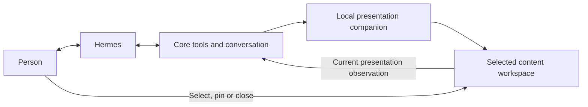

# Contextual presentation alongside Hermes

The personal conversation has one principal agent: Hermes. Core supplies its
shared tools and canonical conversation. An optional local presentation
companion follows the active context and proposes useful content in the existing
workspace while Hermes continues answering. The feature starts unchecked for
each browser visit and applies to retained personal Hermes conversations only.

## Responsibility and flow



The user selects **Affichage contextuel** before a message. The ordinary turn
handler supplies the canonical request, a bounded portion of its already
selected context/history and the current presentation observation. Only public
spoken reply deltas enter subsequent frames; hidden reasoning, raw terminal
output and secret display blocks do not enter this channel. This does not
change Hermes tools, provider, model, context or native execution history.

The companion uses Core's existing local inference capability and the configured
small conversation task, with native routing, pins and admission intact. It
does not install an external agent or duplicate tools in Hermes. Its output
budget and call count are bounded. There is one in-flight companion call across
the service and one latest pending frame per participating session. Updates
coalesce; there is no durable job for every fragment. Superseded admitted calls
retain their native inference settlement and their obsolete output is discarded.

The main reply never awaits the companion. The browser reads advisory status on
a separate, scoped route. Failure or unavailability leaves Hermes and manual
presentation operational. Volatile context expires after five minutes; restart
does not resume or replay accompaniment. Deleting a conversation drops its
advisory context. GET polling never invokes a model.

## Relevance and display authority

The decision is general contextual selection, not a keyword-to-page switch.
The prompt prefers keeping a suitable view and doing nothing when no useful
accompaniment is available. A proposed change needs a reason and an exact quote
from the supplied context. Structural validation rejects unsupported output;
semantic relevance remains something the real-model pilot must measure.

The first slice accepts catalogue pages, text, lists and tables. Pages use the
existing validated identifiers and focus grammar; arbitrary URLs and action
fields are rejected. The ecosystem page reuses GraphysX's rendered tour and node
focus. Repeated requests for the same visible page keep its current frame.
The companion does not generate arbitrary scene code or execute shell commands.
It has no business-effect tools. The content is labelled **Suggestion du
contexte**, and is neither a successful action receipt nor verified inventory.

An explicit display from Hermes pauses accompaniment for that turn. A person's
selection, close or pin immediately stops automatic replacement for the current
turn. **Épingler la vue** prevents companion replacement across later turns;
unpinning permits following on the next message. Delayed stop requests are bound
to their original turn and cannot stop a newer turn.

The selected content uses the existing presentation observation/read contract
on the next ordinary message. The companion's volatile proposals are not a
second conversation store. The browser does not claim the agent saw pixels,
an external tab, or a result merely because content was proposed or opened.

## Extension boundaries

This slice establishes asynchronous visual accompaniment. It does not yet add
autonomous document retrieval, a research-result inbox for Hermes, a continuous
server feed of selected-node events or incremental mutations of a live scene.
Those extensions use the same Core-owned contracts: typed, sourced observations
and suggestions linked to the current conversation and request. They must keep
user selection priority, freshness, scope, one current pending context and the
principal's independent progress. The [companion delivery issue](https://github.com/WindriderQc/AgentX/issues/1158)
owns unfinished work.

The architecture accommodates new views and read capabilities without making
the initial ecosystem, list and terminal examples an exhaustive feature list.
A terminal intervention needs an exact domain identity and read/result evidence
before its visual state can represent a verified change. Sensitive effects stay
prepared for an explicit human action in the owning interface. Privacy filtering
and alternate hardware topologies are separate later choices.

## Test and pilot contract

CPU checks exercise proposal validation, coalescing, stale frames, newer user
turns, call limits, expiry and failures. Isolated HTTP/Mongo tests use the real
Hermes turn handler with synthetic native transport and local inference. They
verify the principal can finish before the companion and preserve family scope.
Browser fixtures use the production workspace, companion controller, scoped
routes and GraphysX embed, with synthetic model decisions. They verify pin,
manual and primary-display priority, topic changes, no-op decisions and failure
isolation. They are not evidence of actual model relevance or physical audio.

```bash
node --test core/surfaces/household/test/presentation-companion.test.js
npm test --prefix core -- --runInBand --runTestsByPath \
  tests/integration/household-companion.test.js \
  tests/integration/household-hermes.test.js
GRAPHYSX_CHECKOUT=/path/to/built/GraphysX-Web \
COMPANION_REPORT_DIR=/path/outside/git \
node core/tests/browser/contextualCompanionJourney.cjs
```

Before a native pilot, submit the existing heavy-work queue request linked to
the coding session and issue. Retain its stable identity and release receipt;
preparing it does not launch a model or approve a campaign. Required deployment
and native execution approvals remain in force.

The pilot uses one new personal Hermes conversation and a small set of benign
requests: discuss a component, build a list, switch subjects, select/pin a view,
and continue while local inference is unavailable. Log actual engine/provider,
principal first response, companion dispatch/result, displayed content and
GraphysX's rendered observation separately. Every visible proposal must belong
to the current subject; obsolete results must never replace the current view.
An unrelated suggestion fails relevance acceptance. There is no latency promise
until observed, and browser success does not qualify microphone/playback.

Source/CI, installed files, native model behavior and owner-device interaction
are separate acceptance stages. Private manifests, prompts, receipts and
screenshots stay outside public Git.
